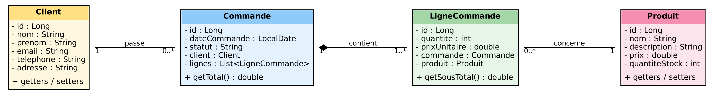
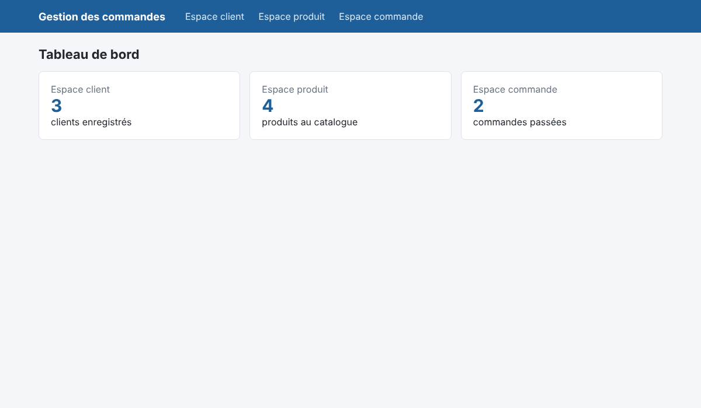
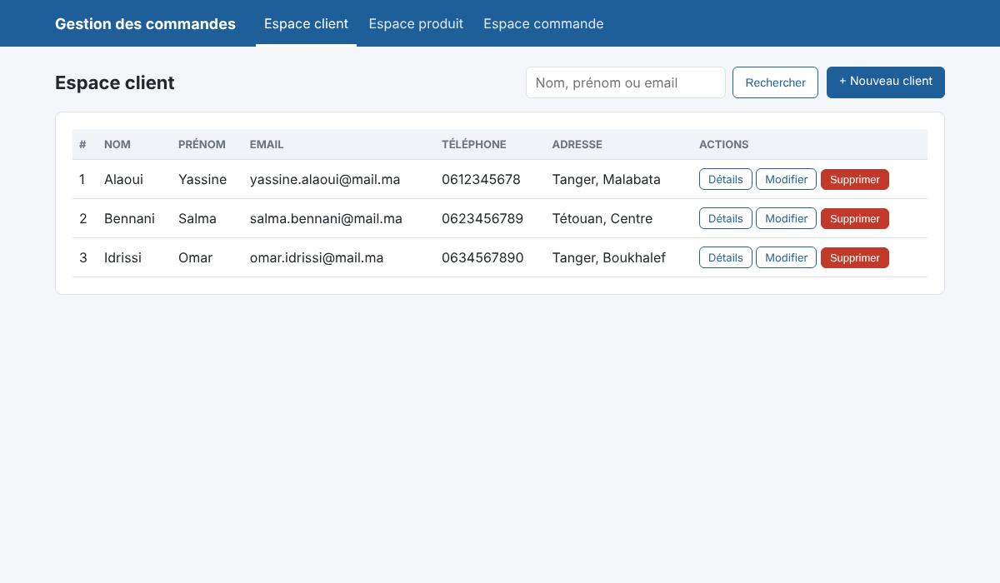
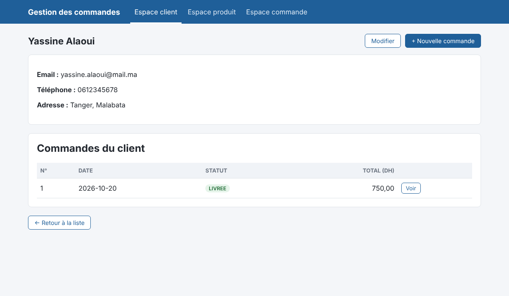
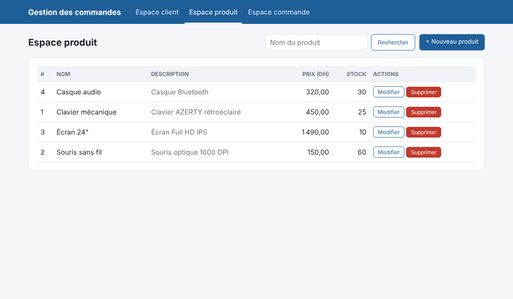
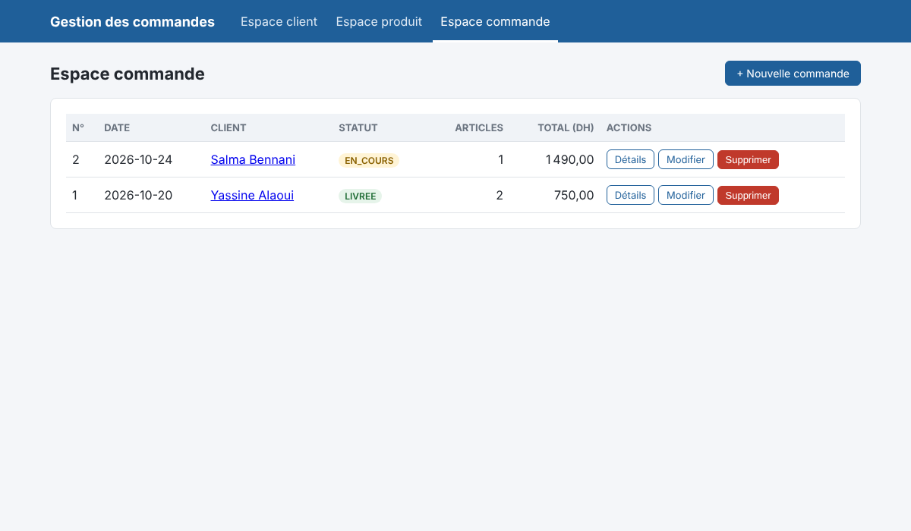
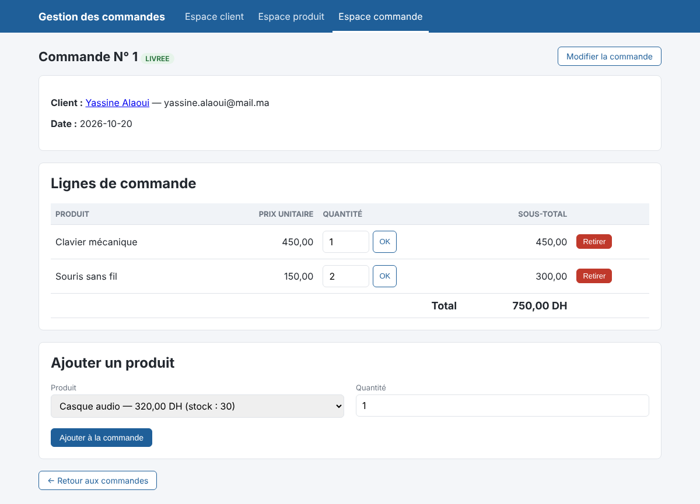

# Mini rapport — Atelier 1 : Application web basée sur MVC et standards JEE

**Université Abdelmalek Essaadi — FST Tanger · Cycle Ingénieur LSI · Module JEE · Pr. ELAACHAK Lotfi**

## 1. Objectif

Maîtriser les standards JEE (Servlet, JSP, Java Bean) en réalisant une application web de gestion des commandes
de plusieurs clients, organisée selon le patron MVC, avec Maven, Tomcat et MySQL.

## 2. Étape 1 — Diagramme de classes



- Un **Client** passe 0 à plusieurs **Commandes** ; une commande appartient à un seul client.
- Une **Commande** est composée (composition) de 1 à plusieurs **LignesDeCommande**.
- Chaque **LigneCommande** concerne un seul **Produit** ; un produit peut figurer dans plusieurs lignes.
- `LigneCommande` porte la quantité et le prix unitaire (figé au moment de la commande) ; `Commande.getTotal()` additionne les sous-totaux.

## 3. Étape 2 — Schéma de la base de données

Passage au modèle relationnel (script complet : `sql/schema.sql`) :

```
client(id PK, nom, prenom, email UNIQUE, telephone, adresse)
produit(id PK, nom, description, prix, quantite_stock)
commande(id PK, date_commande, statut, #client_id → client.id)
ligne_commande(id PK, #commande_id → commande.id, #produit_id → produit.id, quantite, prix_unitaire)
```

- Association 1–N Client/Commande → clé étrangère `client_id` dans `commande` (`ON DELETE CASCADE`).
- Composition Commande/LigneCommande → `commande_id` avec `ON DELETE CASCADE` (une ligne n'existe pas sans sa commande).
- Association N–1 LigneCommande/Produit → `produit_id` avec `ON DELETE RESTRICT` (on ne supprime pas un produit déjà commandé).
- Contraintes `CHECK` : prix ≥ 0, stock ≥ 0, quantité > 0.

## 4. Étape 3 — Projet web dynamique Maven

Projet Maven `war`, web module **6.0** (Jakarta EE 10, donc > 3.0), déployé sur Tomcat 10.1.
Dépendances principales du `pom.xml` :

| Dépendance | Rôle |
|---|---|
| `jakarta.servlet-api` 6.0 (provided) | API Servlet, fournie par Tomcat |
| `jakarta.servlet.jsp.jstl` 3.0 | balises JSTL (`c:`, `fmt:`, `fn:`) |
| `mysql-connector-j` | driver JDBC MySQL |
| `weld-servlet-shaded` + `cdi-api` / `inject-api` | CDI : `@Inject` et `@ApplicationScoped` sur Tomcat |

## 5. Étape 4 — Couche persistance / modèle

| Package | Contenu |
|---|---|
| `ma.fstt.entities` | Java Beans `Client`, `Produit`, `Commande`, `LigneCommande` (constructeur vide, attributs privés, getters/setters, `Serializable`) |
| `ma.fstt.service` | Interface générique `IDao<T>` (save, update, delete, findById, findAll) et interfaces spécialisées `IClientDao`, `IProduitDao`, `ICommandeDao`, `ILigneCommandeDao` |
| `ma.fstt.dao` | Implémentations JDBC `*DaoImpl`, annotées `@ApplicationScoped` (une instance pour toute l'application) |

Choix techniques :
- `PreparedStatement` partout (protection contre l'injection SQL) et `try-with-resources` (fermeture automatique des connexions).
- Les opérations qui touchent le stock (ajout/suppression de ligne, suppression de commande) s'exécutent dans une **transaction**
  (`setAutoCommit(false)` / `commit` / `rollback`) : la ligne et le stock sont mis à jour ensemble ou pas du tout.
- Les paramètres de connexion sont externalisés dans `db.properties`.

## 6. Étape 5 — Servlets et JSP

Les servlets (contrôleurs) reçoivent les DAO par **injection** via leurs interfaces :

```java
@WebServlet("/clients")
public class ClientServlet extends HttpServlet {
    @Inject
    private IClientDao clientDao;
    ...
}
```

Chaque servlet aiguille selon le paramètre `action` (list, new, edit, details, save, delete…), place les Java Beans dans la
requête, puis fait un `forward` vers une JSP placée sous `WEB-INF/views` (inaccessible directement : on passe toujours par le contrôleur).
Après chaque POST, la servlet redirige (pattern **Post/Redirect/Get**) et un message de confirmation est affiché une fois.

Les JSP n'utilisent **aucun scriptlet** : uniquement EL et JSTL (`c:forEach`, `c:if`, `c:choose`, `c:out` pour échapper le HTML,
`fmt:formatNumber` pour les montants, `fn:escapeXml`).

| Espace | Opérations CRUD |
|---|---|
| Client | liste + recherche, ajout, modification, suppression, fiche détaillée avec les commandes du client |
| Produit | liste + recherche, ajout, modification, suppression (refusée si le produit est commandé) |
| Commande | liste avec total, création, modification, suppression ; gestion des lignes (ajout, quantité, retrait) avec contrôle du stock |

### Captures d'écran

| | |
|---|---|
|  |  |
|  |  |
|  |  |

## 7. Tests réalisés

| Scénario | Résultat attendu | OK |
|---|---|---|
| Ajouter / modifier / supprimer un client | Données à jour en base, message de confirmation | ✔ |
| Ajouter un client avec un email existant | Refus : « Cet email est déjà utilisé » | ✔ |
| Ajouter une ligne de 3 unités (stock 5) | Ligne créée, stock = 2 | ✔ |
| Ajouter 10 unités (stock 2) | Refus « Stock insuffisant », rien n'est modifié | ✔ |
| Supprimer une ligne / une commande | Stock restauré | ✔ |
| Supprimer un produit présent dans une commande | Refus avec message explicite | ✔ |
| Saisie avec accents (Élodie, Tétouan) | Stockés et affichés correctement (UTF-8) | ✔ |

## 8. Conclusion

Cet atelier a permis de mettre en œuvre une application JEE complète : modélisation UML, passage au relationnel,
couche DAO découplée par des interfaces et injectée par CDI, contrôleurs Servlet et vues JSP/JSTL. La séparation
Modèle / Vue / Contrôleur rend chaque couche modifiable indépendamment ; par exemple, on pourrait remplacer l'implémentation
JDBC par JPA sans toucher aux servlets ni aux JSP. Pistes d'amélioration : authentification, pagination, pool de connexions
(DataSource JNDI) et passage à JPA/Hibernate.
